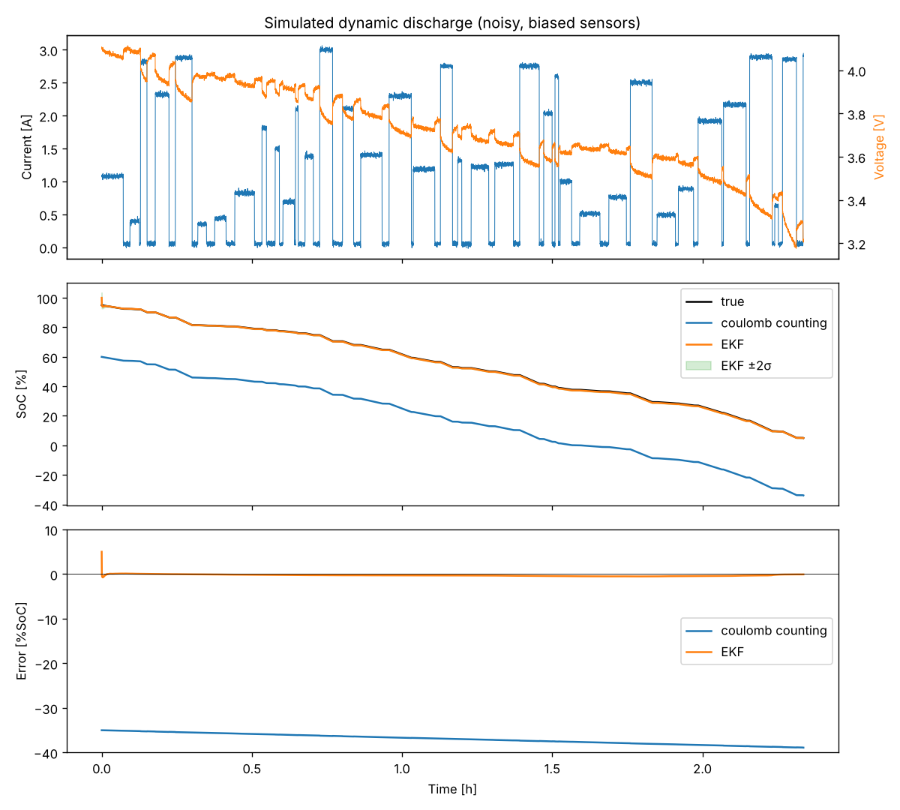

# Battery SoC estimation with an Extended Kalman Filter

State-of-charge (SoC) estimation for a Li-ion 18650 cell using a 1RC equivalent
circuit model and an Extended Kalman Filter (EKF), compared against plain
coulomb counting.

This is step 1 of a larger project: simulation in Python → real measurements
with an ESP32 + INA219/INA226 → automated SIL/HIL tests → SoH estimation.

## Result (simulation)



Scenario: dynamic pulse discharge, current sensor with +50 mA bias and noise,
5 mV voltage noise, and an estimator started at **60 % SoC while the true SoC is 95 %**.

| Estimator        | RMSE after 15 min |
|------------------|-------------------|
| Coulomb counting | ~37 %SoC          |
| EKF              | ~0.4 %SoC         |

Coulomb counting cannot recover from a wrong start value and drifts with sensor
bias. The EKF uses the voltage measurement to correct itself and converges
within a few minutes.

> Note: here the filter uses exactly the same parameters as the simulated
> cell, so this is a best case. Robustness to parameter errors is the next
> thing to test (see Roadmap).

## Model

Discharge current `I` is positive.

```
soc[k+1] = soc[k] - η·I·Δt / (3600·Q)
v1[k+1]  = a·v1[k] + R1·(1 - a)·I          a = exp(-Δt / (R1·C1))
V[k]     = OCV(soc[k]) - v1[k] - R0·I
```

- `R0`: ohmic resistance (instant voltage drop when current changes)
- `R1, C1`: polarisation (slow voltage relaxation after a pulse)
- `OCV(soc)`: open-circuit voltage curve (non-linear, hence the *Extended* KF)

EKF state `x = [soc, v1]`, measurement `V`.
Linearised measurement matrix `H = [dOCV/dsoc, -1]`.

## Run

```bash
python -m venv .venv && source .venv/bin/activate   # Windows: .venv\Scripts\activate
pip install -r requirements.txt
pip install -e .
python scripts/run_demo.py
pytest
```

## Structure

```
src/soc/model.py       1RC cell model and OCV curve
src/soc/estimators.py  Coulomb counter and EKF
src/soc/simulate.py    Synthetic test profile with sensor noise and bias
scripts/run_demo.py    Comparison and plots
tests/                 pytest unit tests
```

## Roadmap

- [x] 1RC model + EKF in simulation
- [ ] Robustness: wrong R0 / capacity in the filter, Q/R tuning
- [ ] Validate on a public 18650 dataset
- [ ] ESP32 + INA219/INA226 data logging, EKF ported to C++
- [ ] SIL test (C++ vs Python reference), simple HIL rig, GitHub Actions CI
- [ ] SoH (capacity fade) estimation
